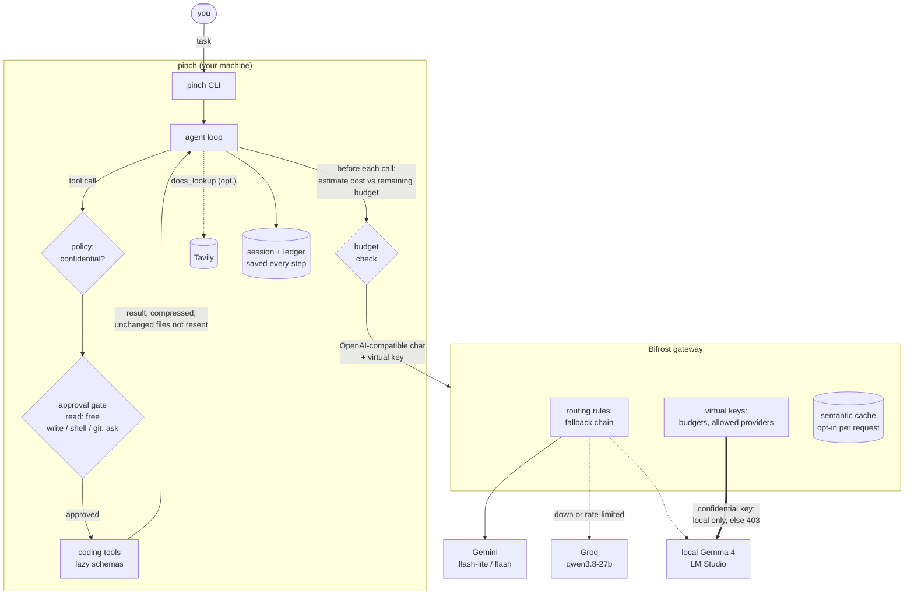

# pinch

A command-line coding agent that finishes real coding tasks on the fewest tokens.
Built for Bifrost Problem Statement 01 (HackCulture global AI hackathon).

**Status: Phase 4a.** Everything runs offline: mock providers behind a real Bifrost gateway (Docker). `uv run pinch prove`
shows the four mandatory requirements working end to end, and ten token-saving techniques (each switchable on its own, one of them the Tavily docs tool) are built and tested offline.
The benchmark harness (pinch against mini-swe-agent, same model, same gateway) is built and validated with mock providers; running it with real models (Phase 4b) needs API keys. See [Benchmark](#benchmark).

## Libraries that existed before the hackathon

[TurboMCP](https://github.com/walker-null-byte/turbomcp) and
[coding-tools](https://github.com/walker-null-byte/coding-tools) are the author's own libraries and were written
before the hackathon. pinch depends on them for its tools; everything else in this repo was written for the hackathon.
TurboMCP comes from PyPI (`turbomcp>=0.3.0`). coding-tools is a single file without packaging, so an unmodified copy lives in
`src/pinch/vendor/` (see `PROVENANCE.md` there).

## Quick start

```sh
uv sync                                     # Python 3.12+, project-local .venv
uv run pytest                               # the whole suite, offline

uv run pinch prove                          # the 4 mandatory requirements, through Bifrost in Docker (needs Docker; ~1 min; mock gateway on :8190, so it can run beside the real one on :8180)

# real providers (Gemini, Groq, local LM Studio) through Bifrost on :8180: see "Real providers" in gateway/README.md
uv run python scripts/init_env.py                          # once: fill the empty virtual keys in .env with random values (prints names only)
uv run python scripts/real_gateway.py up                   # or: docker compose --env-file .env -f gateway/docker-compose.real.yml up -d
uv run pinch "Fix the failing test" --repo /tmp/demo-repo  # then use pinch as usual; stop with: uv run python scripts/real_gateway.py down
# free-tier calls cost $0 in reality; budgets count list-price cost, so limits behave as they would on paid keys

uv run python -m pinch.savings_smoke        # offline byte estimate: --savings all versus none on 3 scripted tasks (add --ablate)
uv run python -m pinch.bench smoke           # benchmark harness check with mock providers (pinch vs mini-swe-agent in containers; needs Docker + `bench setup`)
uv run python scripts/measure_code_mode.py  # what Bifrost Code Mode puts in the prompt, versus pinch full and lazy (needs Docker)

# try the CLI against the mock provider (no gateway)
examples/make_demo_repo.sh /tmp/demo-repo
uv run pinch-mock examples/fix_calc.json --port 8089 &          # scripted "model"
uv run pinch "Fix the failing test" --repo /tmp/demo-repo       # answer y at the prompts
uv run pinch ledger <session id printed at startup>
```

## What it does



Text version: you → pinch CLI → agent loop → (budget check) → Bifrost → model. Each tool call goes through the policy check, then the approval gate, then runs, and its result goes back to the model. Bifrost holds the budgets, the fallback chain and the local-only key for confidential repos. pinch reads them from Bifrost's admin API and enforces them before it calls.

| Piece | File | Notes |
|---|---|---|
| Agent loop | `agent.py` | task, model, tool calls, gate, execute, feed back; stops on finish, step limit or model error |
| Model client | `client.py` | plain `httpx`; base URL, model, key and the **key header name** come from config; keeps `usage` and provider/model fields of every reply |
| Tools | `tools.py` | coding-tools registry loaded in-process. `--mode full` sends all 34 schemas. `--mode lazy` (default) sends `search_tools`, `get_tool` and `call_tool`, plus short schemas for the 6 core tools every task needs (read, grep, edit, write, run a command, list a folder); the other 28 are found with `search_tools` |
| Approval gate | `approval.py` | table of every tool as read / write / shell / git; unknown tools need approval; `call_tool` is unwrapped and the inner tool is checked |
| Policy | `policy.py` | confidential if a `.pinch-confidential` marker exists (in the repo or a parent) or the repo is in `~/.config/pinch/config.toml`; read once at startup; the marker can't be edited or deleted |
| Sessions | `session.py` | JSONL, appended and fsynced after every step; `pinch --resume <id>` |
| Styles | `styles.py` | `normal`, `brief` (default), `tiny`, `caveman` |
| Ledger | `ledger.py`, `prices.toml` | one record per model call; editable price table |
| Mock provider | `mock_provider.py` | scripted replies, scripted 429/500, records every request |
| Gateway client | `gateway.py` | read-only use of Bifrost's admin API: remaining budget, and "this key reaches only local providers" |
| Budget | `budget.py` | the pre-call check |
| Prove | `prove.py` | `pinch prove`: four scenarios through Bifrost, PASS/FAIL with evidence; no pytest needed |
| Savings | `savings/`, `savings_smoke.py` | the ten techniques; the offline smoke |
| Docs lookup | `tavily.py`, `spend.py` | Tavily tool; per-user spend file |
| Gateway setup | `gateway/` | Bifrost config as code (pinned image), demo users, fallback chain, templates for real providers |

## Token-saving techniques

Every technique is switchable by itself: `--savings all` (default), `--savings none`, or a list such as `--savings context,trim`; the same in `config.toml` (`savings = "..."`) or `PINCH_SAVINGS`.
The techniques on for a session are written to its session file and shown by `pinch ledger`, so a benchmark can turn them off one at a time. (`prefix`, a name from an earlier version, is still accepted and ignored.)

pinch always keeps the system prompt, response style and tool schemas byte-identical and first on every call (tools come first in the request body), like any ordinary agent, so provider prompt caching can work; this is not counted as a saving technique and cannot be switched off. An earlier version of the `none` reference added a changing line at the top of the system prompt, which blocked caching: on the first 22 set A tasks 0.3% of its input tokens were served from the provider's cache, against 71% for mini-swe-agent, so its cost per solved task was about twice the baseline's. Token counts were hardly affected (the line was about 7 tokens per call). Those runs are kept, marked, in [`bench/results/run1-superseded.jsonl`](bench/results/run1-superseded.jsonl) and are redone with the fixed code; [`real-smoke.md`](bench/results/real-smoke.md) is from before the fix. Cached input tokens are reported separately in the ledger.

| Technique | What it does | Where |
|---|---|---|
| `context` | The first prompt carries a compact repo map (file tree plus top-level symbols from `ast`) and the few files most relevant to the task, ranked by matching the task text and any traceback. Saves the list-then-read round trips. Never reads `.env`, keys or `.git`. | `savings/context.py` |
| `filememory` | Files are tracked by hash. Re-reading an unchanged file returns "unchanged since step N"; a changed file returns a diff against the version the model saw. | `savings/filememory.py` |
| `smalledits` | Tool descriptions and one system-prompt line steer the model to `edit_file`/`apply_patch` and keep `write_file` for new files. `pinch ledger` reports how often `write_file` still hits an existing file. | `tools.py`, `agent.py` |
| `testcompress` | Test and command output over 1,200 characters is cut to failing test names, each first error and the summary line (hard cap about 1,500). The full output is saved in `.pinch/outputs/` (kept out of `git status`) for the agent to read if it must. | `savings/compress.py` |
| `trim` | Tool output older than `trim_after` (4) steps becomes a one-line stub in the request. File reads are kept until a later read shows the same lines again. The session file keeps everything. | `savings/trim.py` |
| `pretest` | Before the first model call, pinch proposes running the repo's tests once (`test_command`, `PINCH_TEST_COMMAND`, or coding-tools' auto-detect). It is a normal shell approval in interactive use, and a logged auto-approval under `--auto-approve`. The result goes at the end of the first prompt, after the system prompt and tool schemas, so the cached prefix is untouched: a failing run as the compressed failure (names of failing tests, first error, summary; run times removed so the prompt is the same on every run of a task), a passing run as one line, \"tests currently pass\". A failing run is also the session's first red, so `stopongreen` can stop after the model's first correct fix. Left out, with the reason in the session (`pretest` event: `declined`, `timeout`, `command_not_found`, `no_tests_collected`, `no_tests_found`, `blocked`), when the tests could not run. `pinch ledger` shows it. | `agent.py` |
| `stopongreen` | After an approved edit, pinch proposes running the repo's tests (`test_command`, or coding-tools' auto-detect). That is a normal shell approval, and "always" for that exact command works. It stops without another model call **only on a red-to-green change**: the tests must have failed earlier in the session (in a run by the model or by pinch) and pass now. Tests that pass and never failed (a bug fix whose existing tests were already green) do not end the run; the model decides when it is done. The session records which rule fired (`stop_on_green` with `rule: red_to_green`, or `green_not_stopped` with `rule: never_red`). If the short failure comes back, it goes to the model. | `savings/greenlight.py` |
| `cascade` | Starts on `small_model`, escalates once to `big_model` when the tests still fail after N edit-and-test rounds or M tool errors in a row (config). Each escalation is recorded in the ledger. The gateway must route both model names (the demo routing rules keep the caller's model). | `savings/cascade.py` |
| `cache` | Bifrost's exact-match response cache, in a per-run namespace (`x-bf-cache-key` = the session id, so benchmark runs never share answers). Hits are recorded in the ledger with the tokens they saved. | `cli.py`, gateway config |
| `docs` | The Tavily `docs_lookup` tool (below). | `tavily.py` |

The system prompt carries one fixed line for bug fixes ("if no failing test, first add a small test that reproduces the bug"), which gives stop-on-green a red test to turn green. It is the same text on every call, so the cached prefix still works.

Trimming and the provider's prompt cache pull in opposite directions: trimming shortens the history, but when a message becomes a stub the cached prefix is cut at that point. The stub depends only on the message and its age, so everything before it stays identical. `no-trim` against `all` measures the trade-off.

**Never for confidential repos:** `cache` and `docs` are switched off (the session record lists the techniques really on). The budget check is also skipped for them, because the local tier is free.

### What was checked about Bifrost's caches (v2.5.0)

- **Response cache (`semantic_cache` plugin).** It has an exact-match ("direct") mode that needs no embedding provider, but it does need a vector store. `chromem` runs in the gateway process, so no Redis container is needed (Redis or Weaviate are for a shared cache; chromem data stays on one node). The demo gateway uses `chromem` and direct-only mode (`dimension: 1`), so there are no embedding tokens; pinch still records `x-bifrost-cache-input-tokens` in the ledger as `embedding_tokens`.
- A request is only cached when it carries `x-bf-cache-key`. There is no default key in the demo config. Entries are also scoped to the virtual key.
- Defaults that would make it useless for an agent, changed in `gateway/config.json`: `conversation_history_threshold` (default 3 messages, we use 50) and `cache_tool_call_responses` (default off, but most agent replies are tool calls).
- **Honest expectation:** inside one run the history keeps growing, so identical requests are rare and hits will be few. The cache pays when the same task is run again in the same namespace. Benchmark runs use fresh namespaces on purpose.
- A cache hit still reports the original `usage`; pinch records zero billed tokens and the saving separately.
- **Provider prompt caching is different.** Bifrost can add provider cache markers for clients that send none (`prompt_cache.auto_inject` per provider, or the `x-bf-prompt-cache-auto-inject` header). That is for Anthropic-style explicit caching and is a Phase 4 setting with real providers.

### Tavily `docs_lookup`

A READ tool (it changes nothing locally, so no approval) that calls Tavily's search API over plain `httpx`: basic depth, at most 3 results, each snippet cut to about 300 characters, with source URLs. The base URL is configurable (`PINCH_TAVILY_URL`) and the key is `TAVILY_API_KEY`.
Queries are one line, at most 300 characters; code fences and key-like tokens are removed, and the tool description tells the model to send error text and library names only. That last rule is guidance plus clean-up, not proof: pinch cannot tell if a model pastes code in prose. Results are cached for the session, and every call's credits are written to the session ledger.
It is not offered when the `docs` technique is off, when there is no key, or for a confidential repo, and a call to it is refused there.

### Bifrost Code Mode, and why tasks do not run through it

Code Mode makes Bifrost run the tools inside the gateway (sandboxed code that calls them). That would execute writes and shell commands without passing pinch's approval gate, which runs in pinch before execution. So pinch never runs tasks through Code Mode.
`scripts/measure_code_mode.py` only measures what Code Mode puts in the prompt: it registers the same 34 coding-tools as an MCP client in a throwaway gateway and reads the request a mock provider receives.

| What is sent on every request | tools | schema bytes | ~tokens (bytes/4) |
|---|---|---|---|
| pinch `full` | 34 | 12,936 | 3,234 |
| Bifrost MCP, classic (all tools) | 34 | 13,422 | 3,355 |
| Bifrost Code Mode | 4 (`listToolFiles`, `readToolFile`, `getToolDocs`, `executeToolCode`) | 7,038 | 1,759 |
| pinch `lazy` | 9 (`search_tools`, `get_tool`, `call_tool` + 6 core tools) | 2,793 | 698 |

Byte counts, not provider-reported tokens. Code Mode then needs extra calls to read tool stubs (`readToolFile`) and to write code, which this does not include.

### Limits

- The budget read from Bifrost uses the gateway's **admin credentials** (`PINCH_GATEWAY_ADMIN_USER`/`PASSWORD`). Those are an operator-side secret, not something to hand every user. In production a narrower, per-caller read of one's own budget would be better.
- The ledger fallback of the budget check uses a per-user file (`~/.local/share/pinch/spend/<user>.json`, by calendar month), which pinch writes itself: it is only as good as pinch's own accounting.
- The savings smoke is an offline estimate with a rule-based stand-in model. Real numbers need real models (Phase 4).

## How each mandatory requirement is enforced

Run `uv run pinch prove` to watch all four. To see each one live against real providers, `bash scripts/demo.sh <scene>` runs it scene by scene ([docs/DEMO.md](docs/DEMO.md)). Bifrost version checked: v2.5.0 (details and doc links in `gateway/README.md`).

**1. Reliability: failover with a notice.**
Bifrost owns failover: each user's virtual key has a routing rule "cloud-a, then cloud-b, then local" (`gateway/config.json`).
pinch only retries the gateway itself when the gateway is unreachable or answers 5xx after its fallbacks are used up: 5 tries, waiting 2, 4, 8 and 16 s (or the `Retry-After` it is given), and it says so each time. That is long enough for a per-minute limit at the provider that took over: when the whole chain fails, Bifrost reports its first provider's error, so a Groq "try again in 6 s" arrives as the down provider's 502. Per-minute 429s are waited out separately (up to 8 times). Then it
saves the session and prints `pinch --resume <id>`. Every reply tells pinch who answered (`extra_fields.routing_info` and `x-bifrost-routing-info-*` headers).
When that differs from the previous reply, or the first reply came from a fallback, pinch prints a plain notice ("cloud-a did not answer (rate limited or down), so cloud-b ... took over") and records it in
the session file (`provider_changed`) and the ledger (`provider`, `is_fallback`, `primary_provider`). The session is a JSONL file flushed after every step, so a crash loses nothing.

**2. Budget, checked before each call.**
Bifrost's virtual-key budget is the source of truth. Before every call pinch reads the key's remaining budget from the Bifrost admin API (or, if it can't, uses its own ledger against `budget_usd`), and compares it with a
conservative estimate of the call: request characters / 3 as input tokens, plus `max_tokens`, at the `prices.toml` rates. Bifrost books spend a moment late, so pinch also adds up its own calls since it first looked.
If the estimate is more than what is left, pinch does **not** make the call: it saves the session, shows the spend, and offers `[l]` continue on the local tier, `[r]` how to raise the limit, `[q]` quit.
Bifrost's own budget limit (HTTP 402 `budget_exceeded`) is the second layer and gets the same menu.

**3. Code privacy: confidential repos stay local.**
A repo is confidential with a `.pinch-confidential` marker or a listing in `config.toml`; this is read once at startup and the marker can't be edited or deleted. A confidential repo uses only `PINCH_CONFIDENTIAL_KEY`, a Bifrost virtual key whose only provider is `local`.
At startup pinch asks the Bifrost admin API for that key and **refuses to start** unless it is active, not "allow all providers", and every provider on it is in `local_providers`; it also refuses if it can't ask. A gateway on localhost proves nothing,
because Bifrost forwards to the cloud, so the URL is not trusted. Bifrost itself rejects any other provider for that key (HTTP 403 `provider_blocked`), whatever the prompt says or a routing rule names. The semantic cache is opt-in per request
(`x-bf-cache-key`); pinch never sends it for a confidential repo and the demo gateway has no cache. If a reply ever names a non-local provider for a confidential repo, pinch stops the task. (Tavily docs lookup, Phase 3, will be off as well.)

**4. Action approval.**
Described under "Approval gate" below. The check is in pinch's code, before execution, including tools reached through `call_tool`. Prompts and files cannot change it.

### Approval gate

- Reads run freely. Writes, shell commands (running tests counts) and git (even `git status`) need a **y**, **n** or **a** (always for this session, per tool).
- The prompt is written by pinch, shows the exact diff or command, and makes terminal escape characters visible.
- "Always" is scoped: for write and git tools it covers that tool for the session; for shell tools (and unknown ones) only the exact same call, so "always" on `pytest -q` never covers `rm -rf`. The prompt says which.
- `lint_code` counts as shell, because pylint can load plugin code named in the repo's own config.
- The gate is only moved by the `--auto-approve` flag (every use is logged to the session and printed) and by the user's keyboard. Model output, tool results and file contents never reach it.
- To allow read-only git without asking, put `allow_tools = ["git_status", "git_log", "git_diff"]` in `config.toml`.
- Second layer: coding-tools' own guardrails, with `CODING_MCP_ROOT` set to the repo, so file tools can't leave it.
- Not offered to the model: coding-tools' web tools (`internet_search`, `webpage_scrape`) and `restart_server`.

### Response styles

`--style`, `style = "..."` in config, `PINCH_STYLE`, or `/style <name>` in an interactive session.

| Style | What the model writes |
|---|---|
| `normal` | ordinary sentences |
| `brief` (default) | short plain sentences, no filler or recap |
| `tiny` | one line of result, then the diff |
| `caveman` | caveman fragments |

Each instruction is under 5 lines and applies to the model's prose only, never to code, diffs, tool arguments or commit messages.
Approval prompts and errors are written by code in plain language whatever the style.
The `caveman` rules are adapted from [JuliusBrussee/caveman](https://github.com/JuliusBrussee/caveman) (MIT when the rules were taken;
newer releases are Apache-2.0). Thank you, Julius Brussee.

### Configuration

Order: defaults, `~/.config/pinch/config.toml`, environment, flags. See `.env.example` for the variable names. The virtual keys and the gateway admin login are read from the
environment only and are never printed. A `.env` is read from `$PINCH_ENV_FILE`, `~/.config/pinch/.env` or this checkout, **never from the repo being
worked on** (an untrusted repo could otherwise redirect model traffic).

```toml
# ~/.config/pinch/config.toml
style = "brief"
mode = "lazy"
confidential_repos = ["~/work/secret-project"]
allow_tools = ["git_status", "git_log", "git_diff"]
```

## Benchmark

`python -m pinch.bench` runs pinch and a real open-source baseline, [mini-swe-agent](https://github.com/SWE-agent/mini-swe-agent) (MIT, pinned to 2.4.6), on the same tasks,
through the same Bifrost gateway, on the same model. Pass or fail is decided outside the agent; tokens come only from the provider-reported `usage` that Bifrost relays; every run is one row of JSONL.

**Every number the harness produces from mock providers is labelled MOCK** (console banner, `"mock": true` in each row, MOCK in the report titles). The mock model is a script; those numbers only show that the pipeline works.
The only real-model result so far is a 3-run smoke on one easy exercise ([`bench/results/real-smoke.md`](bench/results/real-smoke.md): baseline versus pinch `none` and `all`). **One task is not evidence of savings**: it only shows the pipeline works against real models. The full run is not done.

### Commands

```sh
uv run python -m pinch.bench setup          # once: pull python:3.12.15-slim-bookworm, build two tool venvs under bench/.cache/tools (about 0.7 GB)
uv run python -m pinch.bench list -v        # the task sets
uv run python -m pinch.bench validate       # no model: for every task, unsolved must FAIL its check and the reference solution must PASS
uv run python -m pinch.bench plan --modes everything --repeat 3     # how many runs and model calls a configuration makes

uv run python -m pinch.bench smoke          # OFFLINE end-to-end check, 2 tasks of A + 1 of B, mock providers behind the real Bifrost (needs Docker)
uv run python -m pinch.bench smoke --with-docs ...   # also one set C task with docs-on / docs-off against a mock Tavily

# the real thing (Phase 4b): needs PINCH_GATEWAY_KEY (and TAVILY_API_KEY for docs-on) in pinch/.env
uv run python -m pinch.bench run --set A,B,C --modes core --model <name> --repeat 3 --out bench/results/run1.jsonl                    # all 47 tasks
uv run python -m pinch.bench run --subset ablate15 --modes ablate,styles --model <name> --repeat 3 --out bench/results/run1.jsonl --resume   # 15 tasks
uv run python -m pinch.bench run --set C --modes docs --model <name> --repeat 3 --out bench/results/run1.jsonl --resume
uv run python -m pinch.bench run --subset ablate15 --modes cache-twice --model <name> --out bench/results/run1.jsonl --resume
uv run python -m pinch.bench run ... --out bench/results/run1.jsonl --resume       # continue a stopped run
uv run python -m pinch.bench summarize bench/results/run1.jsonl --print            # writes run1.md and run1.csv next to it
uv run python -m pinch.bench clean          # remove leftover bench containers and work dirs
```

`run` options worth knowing: `--only <ids>`, `--limit N` (first N tasks of each set), `--subset ablate15` (all 8 set B tasks + 7 set A exercises spread over difficulty: proverb, dominoes, list-ops, wordy, react, forth, paasio; meant for the ablation and style runs, while `core` runs on all 47), `--jobs N` (parallel runs; free tiers want 1), `--delay S`, `--budget-usd X`, `--max-steps` and `--max-tokens` (the same for both agents),
`--small-model`/`--big-model` (turns the cascade on), `--tool-mode lazy|full`, `--min-call-interval S` (default 4.5: seconds between model calls inside each agent process, the same for both agents; Gemini's free tier allows 15 a minute).

Rate limits: a per-minute HTTP 429 is waited out, never fatal. pinch's client and mini-swe-agent (through a wrapper around its model call, nothing else changed) both honour the provider's "retry in N s" (at most 120 s, up to 8 times) and the report excludes those waits from its times. Only a per-day limit stops a run, or a rate limit that has not cleared for 15 minutes. Pacing is per process, so `--jobs` above 1 shares one limit.

### Modes

| Mode | What runs |
|---|---|
| `baseline` | mini-swe-agent, its own tool-calling config, only the connection changed (litellm to Bifrost's OpenAI-compatible endpoint, `x-bf-vk` header added at call time) |
| `none`, `all` | `pinch --savings none` / `--savings all`, both with the default style `brief` |
| `no-<technique>` | `all` minus one of `context filememory smalledits testcompress trim pretest stopongreen cascade cache` (the ablation; `no-cascade` only with `--small-model/--big-model`) |
| `style-normal`, `style-tiny`, `style-caveman` | `all` with another response style (`brief` is `all`) |
| `docs-on`, `docs-off` | set C only: with and without the Tavily `docs_lookup` tool |
| `cache-twice` | the same task twice in one cache namespace, to show cache hits. Reported separately; never in the averages |

Macros: `core` (baseline, none, all), `ablate` (none, all and every `no-` including `no-pretest`, except `no-cache`, which cannot show an effect with per-run namespaces; ask for it by name if you want it, and use `cache-twice` for cache evidence), `styles`, `docs`, `everything`. pinch runs use `--auto-approve` (benchmark only). **Every auto-approval is logged** in the run's session file, counted in the report, and stated in its methodology section.
Real runs get a fresh cache namespace each, so there are no cross-run cache hits. The Tavily tool is offered on set C only, so Tavily credits go where the comparison is.

### Task sets

| Set | Tasks | Source |
|---|---|---|
| A | 34 | Python exercises of [Aider's polyglot benchmark](https://github.com/Aider-AI/polyglot-benchmark), pinned commit `7e0611e`; Exercism content, MIT (`bench/tasks/A/SOURCE.md`, licence text included). Pass = the exercise's own tests, restored to pristine, pass |
| B | 8 | Real bug fixes from permissively licensed pure-Python projects (boltons, humanize, more-itertools, cachetools, parse, python-dotenv, xmltodict, toolz; MIT or BSD-3). `repo/` is the project one commit before the fix, the fix's tests are the hidden check; repository, commit and licence per task in `bench/tasks/B/SOURCE.md` |
| C | 5 | **Written by us** (marked `authored_by: pinch-team`) for the Tavily comparison: features added in 2026 releases of click 8.5, pytest 9.1 and 9.2, anyio 4.16, with the versions pinned (`bench/tasks/C/SOURCE.md`) |

Sets A and B use pytest in a small venv; set C pins the three libraries. `validate` checks all 47 tasks against their reference solutions (A: Exercism's `example.py`; B: the upstream fix; C: ours).
SWE-bench is not used: it is too heavy for the disk this was built on.

### How a run works

1. A fresh copy of the task folder is mounted into a throwaway container of the pinned image (`--rm`, host networking to reach Bifrost, memory and process caps, run as the host user). Model-generated commands never run on the host.
2. The agent runs in it: pinch (`pinch_run.py`) or mini-swe-agent (`mini_run.py`). The gateway key is passed by name (`docker -e NAME`), removed from the environment before any tool can run, and sent as the `x-bf-vk` header; a test checks it never reaches a command's output or mini's trajectory.
3. After it stops, a **fresh** container lays the check files over the work dir (restored tests, or the hidden upstream tests), deletes cached bytecode and runs the check. Pass = exit code 0. What the agent claims is never consulted.
4. Tokens, calls, cost (provider-reported tokens times `src/pinch/prices.toml`, one table for both agents), time and the other fields become one row. The session or trajectory (gzipped) and the diff are kept under `bench/results/artifacts/`.

Rate limits (HTTP 429) are waited out with a growing delay and the run is retried; quota or budget exhaustion, a rejected key or model name, or a streak of infrastructure failures stop the whole run cleanly (exit code 3), and `--resume` continues it.
A run that failed on infrastructure stays in the file with `status: "infra_error"` and a reason, is run again on `--resume`, and is in no average.

pinch runs with `PYTHONDONTWRITEBYTECODE=1` set for every tool it executes (and restored afterwards), so a test run never trusts a stale `.pyc` after two quick edits (`tests/test_bytecode.py` shows the failure and the fix).

### Reading the report

`summarize` writes per set and mode: pass rate, average and median tokens, **tokens per solved task** (all tokens spent, failed runs included, divided by runs that passed), cost per solved task, calls and time; then an ablation table (each technique's extra tokens and share of the total saving, on paired tasks), a style table, a docs on/off table and the same-task-twice table.
The methodology (models, task counts, how pass is checked, auto-approval, what was excluded and why) is written into the report itself.

Sample, from `bench/results/mock-smoke.md` (**MOCK**: scripted model, 3 tasks, one run each; one of the A tasks is deliberately unsolved by the stand-in model to exercise the failing path):

| set | mode | runs | solved | avg tokens | tokens / solved | avg calls |
|---|---|---|---|---|---|---|
| A | baseline (mini-swe-agent) | 2 | 1 (50%) | 10,556 | 21,112 | 5.0 |
| A | none | 2 | 1 (50%) | 10,299 | 20,598 | 4.0 |
| A | all | 2 | 1 (50%) | 6,150 | 12,299 | 2.0 |
| A | no-pretest | 2 | 1 (50%) | 8,576 | 17,151 | 3.0 |
| B | baseline | 1 | 1 (100%) | 16,993 | 16,993 | 5.0 |
| B | none | 1 | 1 (100%) | 17,219 | 17,219 | 5.0 |
| B | all | 1 | 1 (100%) | 26,533 | 26,533 | 4.0 |
| B | no-pretest | 1 | 1 (100%) | 34,104 | 34,104 | 5.0 |

What the stand-in model shows about the mechanism, not about any real model: with `pretest`, pinch runs the tests before the first call and the model skips running them itself. On the A exercise they start red, so the first correct fix is followed by a green run and stop-on-green fires (2 calls instead of 3). On the B task they start green, so the first prompt gets the one-line "tests currently pass" note and the green run after the fix does not end the run (rule `never_red`). The token counts come from the mock's size-based usage and mean nothing.

Limits, also stated in each report: the sandbox has internet access (it needs the gateway), so an agent could fetch outside information; one sample per cell unless `--repeat` is raised; models are not deterministic.
The default for trimming is unchanged; the ablation (`no-trim` against `all`) decides it with real cached-token counts.

## Tests

`uv run pytest` runs everything against mock providers (the `test_bench_docker.py` tests need Docker and `python -m pinch.bench setup`, and are skipped without them), including the measured tool-schema size (full vs lazy), which is printed. `tests/test_prove.py` runs `pinch prove` for real and is skipped when Docker or the pinned image is missing (`docker pull maximhq/bifrost:v2.5.0`).

## License

AGPL-3.0-or-later. See `LICENSE`.
